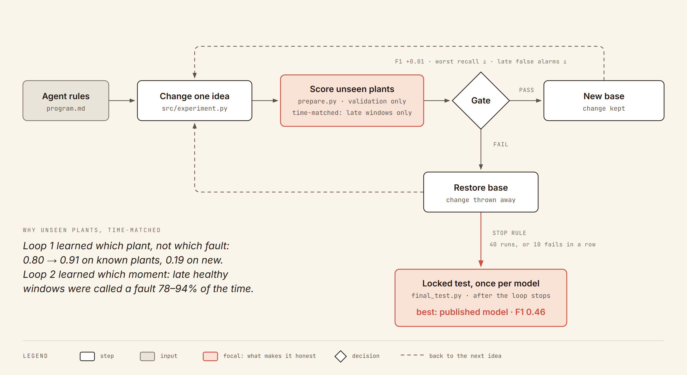

# Solar fleet ops: ML detects, an agent acts

An LLM agent is good at turning a detection into a clear work order. It is not a fault detector. This repo splits the job:

- **Physics features and a per-site baseline** say what "normal" looks like for each plant.
- **ML models** decide whether something is wrong and what it is, with numbers you can audit.
- **The agent** turns those detections into a ranked work-order queue that a human approves.

Everything runs on real, labelled fault experiments from a grid-connected PV system ([GPVS-Faults](https://data.mendeley.com/datasets/n76t439f65/1)), with no API key needed.

```
sensor windows ──► physics features ──► per-site baseline (z-scores)
                    (DC vs AC power,          │
                     phase imbalance,         ├─► control chart ──► IS something wrong?   (unsupervised)
                     DC-link ripple)          └─► gradient boosting ► WHAT is it?          (supervised, 8 classes)
                                                        │
                       debounce ► incident ► power lost vs baseline ► kWh/day at risk
                                                        │
                       playbook + priority ► work order ► awaiting human approval   (optional LLM rewrite, template fallback)
```

## Results (held-out data)

Split: inside each experiment, the earlier 70% of windows train and the later 30% test. Neighbouring 0.1 s windows are nearly identical, so a random shuffle would leak answers into the test set.

| Mode | Model | Accuracy | Macro-F1 | Worst-class recall |
|---|---|---|---|---|
| MPPT | Always "healthy" (baseline) | 56% | 0.09 | 0% |
| MPPT | Gradient boosting, raw features | 84% | 0.83 | 75% |
| MPPT | Gradient boosting, site-baseline features | 83% | 0.82 | 76% |
| MPPT | 1D-CNN on raw signals | 67% | 0.70 | 47% |
| IPPT | Always "healthy" (baseline) | 56% | 0.09 | 0% |
| IPPT | Gradient boosting, raw features | 83% | 0.74 | 0% |
| IPPT | Gradient boosting, site-baseline features | 81% | 0.74 | 0% |
| IPPT | 1D-CNN on raw signals | 42% | 0.51 | 0% |

**Why accuracy isn't the metric:** a model that never raises an alarm scores 56% accuracy here, with a macro-F1 of 0.09. On a real fleet, where faults are far rarer than in this dataset, the same do-nothing model would score well above 90%. Per-fault recall and the false-alarm rate are what an operator needs.

| Mode | Unsupervised detector | Precision | Recall | False alarms on healthy |
|---|---|---|---|---|
| MPPT | Isolation Forest, raw features | 100% | 28% | 0% |
| MPPT | Control chart on site baseline, k=4 | 96% | 66% | 2% |
| MPPT | Control chart on site baseline, k=6 | 100% | 54% | 0% |
| IPPT | Isolation Forest, raw features | 0% | 0% | 0% |
| IPPT | Control chart on site baseline, k=4 | 95% | 68% | 3% |
| IPPT | Control chart on site baseline, k=6 | 99% | 58% | 1% |

**Per-site baselines generalise.** Training on one operating mode and testing on the other, gradient-boosting macro-F1 rises from **0.18 to 0.49** (MPPT→IPPT) and from **0.31 to 0.52** (IPPT→MPPT) once features are expressed relative to each site's own healthy history.

**The two layers cover each other.** The control chart misses partial shading entirely (0% recall), but the supervised classifier catches it at 100% (MPPT) and 95% (IPPT) recall. *Later check: shading moves no feature beyond the drift a healthy run shows over the same time, so these same-plant scores likely reflect drift and plant identity. See the research loop below.*

Full numbers: [`reports/metrics.json`](reports/metrics.json) and [`reports/results.md`](reports/results.md).

## Automated research loop

Modelled on [karpathy/autoresearch](https://github.com/karpathy/autoresearch): an agent edits one file (`src/experiment.py`), a fixed harness (`src/prepare.py`) scores it, and a gate keeps or discards each change. The agent's rules are in [`program.md`](program.md). Every attempt is logged, including the failures.



**Split.** Each ~14 s run has a healthy first half and a second half that holds the fault (in the healthy run, more healthy time). Inside each half, in time order: 55% train, 15% validation, 30% locked test. The loop only ever sees validation. `src/final_test.py` scores the test set after the loop stops.

### Loop 1 found a shortcut: plant identity

Every GPVS experiment contains exactly one fault type, so "which experiment is this?" and "which fault is this?" are the same question. Gradient boosting names the experiment from its *healthy* windows alone with 100% accuracy (chance is 12.5%).

The first loop scored the experiments it trained on. Over 18 runs, validation macro-F1 rose from 0.80 to 0.91. On experiments whose faults it had never seen, the "improved" model got 0.19, against the baseline's 0.50. It had learned to recognise plants, not faults. Log: [`reports/experiments_within_plant.tsv`](reports/experiments_within_plant.tsv).

### Loop 2 scored unseen plants, and found a second shortcut: drift

The harness then trained on one control mode's 8 experiments plus the other mode's healthy "commissioning" windows, and named faults on that other mode. That is the fleet case: a new plant has a healthy history, but its faults haven't happened yet. Best of 19 tried was clipping each site z-score to ±5, at 0.52 → 0.59 on the locked test ([log](reports/experiments_unseen_plant.tsv), [test](reports/final_test_unseen_plant.json)).

That number did not survive the next check:

- **Every run drifts.** Over 14 s, mean DC-link voltage in the *healthy* run falls by about 2 standard deviations. A classifier trained to tell early from late healthy windows in one mode does it at 87–88% balanced accuracy in the other. Regressing out grid-side signals, fitted on commissioning windows as a new plant would allow, still leaves it at 81–87%. Nothing logged explains the drift, so no feature fix removes it (`python -m scripts.drift_probe`).
- **Fault test windows were all late in their run, and healthy test windows early.** So "late" could stand in for "faulty".
- **Treated like a fault run** (an early-only reference, late windows judged), the healthy run's late windows were called a fault 78–94% of the time by the loop-2 winner.
- **Several faults appear well after the stated midpoint, or never.** Measured against each run's early healthy windows, F1 and F2 show at 60–67% of the run and F3 only in its last 3–14%. F7 builds up slowly. F4 (partial shading) moves no feature beyond healthy drift in either mode.

So the harness changed again (interim log: [`reports/experiments_drift_check.tsv`](reports/experiments_drift_check.tsv)). Commissioning is now first halves only. The gate is **time-matched**: it scores only second-half windows, where the healthy run and every fault run cover the same stretch of time. Its false-alarm rate is the share of the healthy run's late windows called a fault.

### Loop 3, time-matched: no change passed

Ten changes tried, none kept, so the loop stopped ([`reports/experiments.tsv`](reports/experiments.tsv)). They included ideas from a [leakage-aware GPVS study](https://github.com/KhandokerSamiulHoque/gpvs-fault-detection) (a 1D-CNN on per-plant-referenced waveforms), drift-labelled healthy examples, and a two-stage detect-then-name model. Every change that cut false alarms also cut macro-F1, and the gate, fixed before the loop, requires both.

Locked test, unseen plants, time-matched (mean of 3 seeds and both directions; [`reports/final_test.json`](reports/final_test.json)):

| Model | Macro-F1 | IPPT→MPPT | MPPT→IPPT | Late healthy windows called a fault | All-window accuracy | All-window false alarms |
|---|---|---|---|---|---|---|
| Published model | **0.46** | 0.53 | 0.39 | 87% | 68% | 21% |
| Loop-2 winner (±5 clip) | 0.43 | 0.43 | 0.42 | 82% | 67% | 20% |
| [Detect-then-name](docs/candidates/detect_then_name.py) (a discard) | 0.39 | 0.43 | 0.35 | **26%** | **71%** | **5.6%** |

The test set has now been scored for three models. None was chosen by its test score: the gate decided on validation, and the discard is shown because it's a different trade-off, not a better model.

Recall by class, same test:

| Model | Late healthy | F1 inverter | F2 sensor | F3 grid | F4 shading | F5 open circuit | F6 PI gain | F7 controller |
|---|---|---|---|---|---|---|---|---|
| Published model | 0.13 | 0.35 | 0.85 | 0.35 | 0.58 | 0.90 | 0.28 | 0.33 |
| [Detect-then-name](docs/candidates/detect_then_name.py) | 0.74 | 0.48 | 0.85 | 0.04 | 0.00 | 0.90 | 0.15 | 0.30 |

What this supports:

- **Two faults transfer to a plant whose faults the model has never seen:** the feedback sensor fault (F2) and PV open circuit (F5), at 0.85–0.90 recall.
- **The rest don't, on this data.** The published model's 0.58 on partial shading disappears once a model has to tell shading from healthy drift.
- **The published model cannot run unattended on a new plant.** It calls 87% of late healthy windows a fault. Detect-then-name cuts that to 26%, at the cost of naming fewer faults. Which one to deploy depends on what a false alarm costs, and that's an operator's call.

### How published GPVS results were measured

Details and quotes: [`docs/gpvs_literature_splits.md`](docs/gpvs_literature_splits.md).

| Paper | Reported | Split, as the paper describes it | Tested on unseen experiments? |
|---|---|---|---|
| Bakdi et al., IJEPES 2021 (dataset authors) | Detection only, <1% false alarms | Time-ordered | No |
| Wali & Khan, arXiv 2021 | 100% accuracy | 70:30; how rows were assigned is not stated | No |
| Devi & Srivenkatesh, ISI 2023 | 99.947% accuracy | Not stated | No |
| Teta et al., Sci. Rep. 2024 | 100% / 99.86% | 70/15/15; how images were assigned is not stated | No |
| Zhang et al., Sensors 2025 | 100% accuracy | Stratified split of overlapping stride-2 windows, so near-copies of test windows are in training | No |
| Jorry et al., arXiv 2026 | Detection only | Time-ordered | No |

Because each experiment has one fault, a split inside the experiments cannot separate fault recognition from plant recognition. That does not show the numbers above are wrong. It shows these setups cannot rule the shortcut out.

## The agent's output

`python -m src.agent` replays the eight MPPT experiments as eight plants and produces [`reports/work_orders.md`](reports/work_orders.md):

| # | Plant | Suspected fault | Confidence | Severity | Power lost | kWh/day at risk |
|---|---|---|---|---|---|---|
| 1 | F1M | inverter fault (IGBT) | 1.0 | critical | 196.1 W | 0.98 |
| 2 | F5M | PV array open circuit | 0.94 | high | 188.5 W | 0.942 |
| 3 | F2M | feedback sensor fault | 1.0 | high | 0.1 W | 0.0 |
| 4 | F6M | boost converter controller fault (PI gain) | 1.0 | medium | 3.3 W | 0.016 |
| 5 | F7M | boost converter controller fault | 0.8 | medium | 0.0 W | 0.0 |

The healthy plant (F0M) raises no incident. Every work order is held at `awaiting approval`, so a person decides.

## Limitations

- **The classifier over-calls "grid anomaly" on slow healthy drift.** Only 31 grid-anomaly windows exist in MPPT mode. So the agent lets the control chart decide *whether* there's an incident, and uses the classifier only to *name* it. The cost: the subtle grid-anomaly (F3M) and partial-shading (F4M) plants pass without an incident in the replay. More labelled data, or a rolling baseline, is the fix.
- **Fault onset isn't published.** The dataset says faults were "introduced manually halfway", so the middle 10% of each experiment is dropped. Measured from the signals, several faults show up later than that, or never (see the research loop), so some fault-labelled windows look healthy.
- **k for the control chart** was compared after seeing these results; the table shows the trade-off across k instead of claiming one tuned value.
- **The agent replays the experiments the classifier trained on.** The held-out numbers above are same-plant scores, and drift inflates them. The research loop's time-matched unseen-plant numbers are the honest fleet estimate.
- **This is lab data at ~200 W scale.** kWh/day assumes 5 full-sun hours (`SUN_HOURS` in `src/agent.py`).
- **The CNN underperforms gradient boosting.** With ~650 training windows per mode, hand-built physics features beat learned ones.

## Next

- A day-ahead forecast layer on real field data (NREL PVDAQ, CC BY 4.0), comparing a time-series foundation model against a seasonal-naive baseline, to price downtime properly.
- Data with more than one run per fault and per healthy plant. With one run each, drift, plant identity and fault are hard to pull apart, and no model change here beat that.
- Let an operator set a false-alarm budget, and choose between the published model and detect-then-name against it.
- Label each window by measured onset rather than the run's midpoint.

## Run it

```bash
pip install -r requirements.txt
python scripts/fetch_data.py   # ~85 MB from Mendeley Data
python -m src.train            # trains, evaluates, writes reports/ and models/
python -m src.agent            # replays the fleet, writes reports/work_orders.md
python -m pytest -q            # data-free unit tests (also run in CI)
python -m src.prepare "what changed"   # one research-loop experiment, scored on validation only
python -m src.final_test "label"       # after the loop: score the locked test set
```

Optional: set `OPENAI_API_KEY` (and `OPENAI_MODEL`) to have an LLM rewrite each work order in plain language. If the call fails, the template work order stands.

## Data and licence

Data: A. Bakdi, A. Guichi, S. Mekhilef, W. Bounoua, *GPVS-Faults: Experimental Data for fault scenarios in grid-connected PV systems under MPPT and IPPT modes*, Mendeley Data, V1, 2020, [doi:10.17632/n76t439f65.1](https://doi.org/10.17632/n76t439f65.1), CC BY 4.0. It is downloaded by the script, not redistributed here.

Code: MIT. Author: [Huzaifa Ansari](https://uzaifadev.com).
